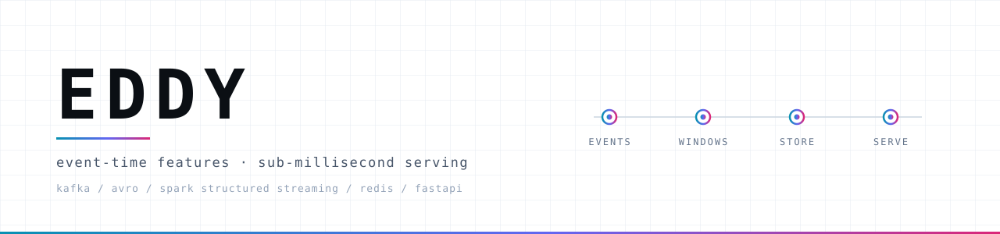
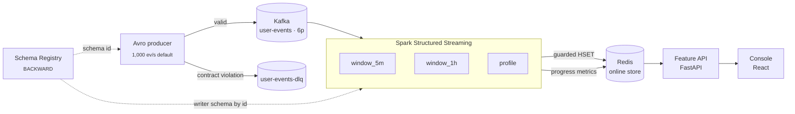

<p align="center">
  <picture>
    <source media="(prefers-color-scheme: dark)"  srcset="docs/banner-dark.svg">
    <source media="(prefers-color-scheme: light)" srcset="docs/banner-light.svg">
    
  </picture>
</p>

<p align="center">
  <a href="#quick-start"><kbd> &nbsp;Quick start&nbsp; </kbd></a>&nbsp;
  <a href="#architecture"><kbd> &nbsp;Architecture&nbsp; </kbd></a>&nbsp;
  <a href="#contracts"><kbd> &nbsp;Contracts&nbsp; </kbd></a>&nbsp;
  <a href="#invariants"><kbd> &nbsp;Invariants&nbsp; </kbd></a>&nbsp;
  <a href="#benchmark"><kbd> &nbsp;Benchmark&nbsp; </kbd></a>&nbsp;
  <a href="#failure-modes"><kbd> &nbsp;Failure modes&nbsp; </kbd></a>
</p>

<p align="center">
  
  
  
  
  
  
  
</p>

<p align="center">
  ⭐ <b>If you find this project useful, please consider giving it a star on GitHub!</b>
</p>


## What this is

A reference implementation of the part of an ML platform that everyone hand-waves: **getting event-time features out of a stream and into a model's request path without lying about freshness.**

Producers write Avro to Kafka, and every record is checked against a registered contract. Spark Structured Streaming reduces the stream into per-user sliding windows and a profile. Redis serves the result. A FastAPI endpoint and a React console sit on top. One `docker compose up` brings the whole thing up.


## Datasheet

<table>
  <tr>
    <td width="33%" valign="top">
      <b>TRANSPORT</b><br>
      <sub>Kafka 3.8 · KRaft (no ZooKeeper)<br>
      6 partitions · keyed by <code>user_id</code><br>
      idempotent producer · <code>acks=all</code> · lz4</sub>
    </td>
    <td width="33%" valign="top">
      <b>COMPUTE</b><br>
      <sub>Spark Structured Streaming 3.5<br>
      3 independent queries<br>
      RocksDB state store · watermarked</sub>
    </td>
    <td width="33%" valign="top">
      <b>STORE</b><br>
      <sub>Redis 7.4 online store<br>
      hash-per-user · TTL-bounded<br>
      guarded writes via Lua</sub>
    </td>
  </tr>
  <tr>
    <td valign="top">
      <b>SERVE</b><br>
      <sub>FastAPI · single + batch (1,000 users)<br>
      pipelined Redis round trip<br>
      freshness reported per response</sub>
    </td>
    <td valign="top">
      <b>CONTRACTS</b><br>
      <sub>Confluent Schema Registry<br>
      BACKWARD compatibility<br>
      numbered Avro versions · CI gate</sub>
    </td>
    <td valign="top">
      <b>GUARANTEES</b><br>
      <sub>exactly-once source offsets<br>
      idempotent upserts<br>
      no stale overwrites on replay</sub>
    </td>
  </tr>
</table>


## Demo

<p align="center">
  <a href="docs/demo.mp4">
    
  </a>
</p>

<p align="center">
  <b><a href="docs/demo.mp4">90-second narrated walkthrough (MP4)</a></b><br>
  <sub>voice-over · burned-in subtitles · <a href="docs/demo.srt">SRT</a></sub>
</p>


## Architecture



### Signal path, hop by hop

| # | Hop | What happens |
|---|---|---|
| 1 | **Encode** | Producer serialises against the newest local `.avsc`. No auto-registration — an unregistered change fails here, not in production. |
| 2 | **Validate** | Registry returns the schema id; malformed records go to `user-events-dlq` with the serialisation error attached. The stream never stops. |
| 3 | **Reduce** | Three independent Spark queries cut sliding windows (`5m/1m`, `1h/10m`) and a last-seen profile. Event-time only, watermarked at 2 min. |
| 4 | **Write** | A Lua script upserts the Redis hash only if the incoming window is at least as new as the stored one. |
| 5 | **Serve** | FastAPI reads the hash, returns the vector plus freshness and lookup latency. |


## Contracts

Avro schemas live in [`schemas/user_event/`](schemas/user_event) as numbered versions. `v2` adds optional `session_id` and `device` — a BACKWARD-compatible change.

**Compatibility matrix**

| Change | Verdict | Why |
|---|:---:|---|
| Add field **with** default | ✅ | old readers skip it |
| Add field **without** default | ❌ | old readers cannot resolve |
| Remove field **with** default | ✅ | new readers fall back |
| Remove field **without** default | ❌ | data loss on replay |
| Widen `int → long` | ✅ | promotable |
| Narrow `long → int` | ❌ | truncation risk |
| Rename field (no alias) | ❌ | resolves to `null` |

**Enforcement**

- `setup` pins the subject's compatibility level and registers each version **in order**, refusing anything the registry flags.
- `python -m eddy.compat_check` is the CI gate — it rejects PRs that add fields without defaults or change field types. Add `--registry` to also ask the live registry.
- **Consumers read with the exact writer schema.** Spark pulls the schema id from each Confluent wire-format header, decodes with that version, then projects onto the latest reader schema. `v1` and `v2` events coexist on the topic and both land in one struct.


## Features

<table>
  <tr>
    <th align="left">Group</th>
    <th align="left">5-minute window</th>
    <th align="left">1-hour window</th>
  </tr>
  <tr>
    <td><b>Counts</b><br><sub>event · view · add-to-cart · purchase</sub></td>
    <td><code>event_count_5m</code> …</td>
    <td><code>event_count_1h</code> …</td>
  </tr>
  <tr>
    <td><b>Value</b><br><sub>spend · refunds</sub></td>
    <td><code>spend_5m</code>, <code>refund_amount_5m</code></td>
    <td><code>spend_1h</code>, <code>refund_amount_1h</code></td>
  </tr>
  <tr>
    <td><b>Ratios</b><br><sub>AOV · cart→purchase</sub></td>
    <td><code>avg_order_value_5m</code>, <code>cart_conversion_5m</code></td>
    <td><code>…_1h</code></td>
  </tr>
  <tr>
    <td><b>Cardinality</b><br><sub>HyperLogLog</sub></td>
    <td><code>distinct_products_5m</code> …</td>
    <td><code>…_1h</code></td>
  </tr>
  <tr>
    <td><b>Freshness</b></td>
    <td><code>last_event_ms_5m</code>, <code>window_end_ms_5m</code></td>
    <td><code>…_1h</code></td>
  </tr>
  <tr>
    <td><b>Profile</b></td>
    <td colspan="2"><code>last_event_type</code> · <code>last_category</code> · <code>last_product_id</code> · <code>last_device</code> · <code>last_seen_ms</code></td>
  </tr>
</table>


## Invariants

<kbd>I1</kbd> **Event time, not processing time.** Windows are cut by the event's own timestamp, watermarked at `WATERMARK_DELAY` (default 2 min). State is bounded by the watermark and lives in RocksDB.

<kbd>I2</kbd> **Windows are independent.** Each window size is its own streaming query, so for a few seconds one can trail another. Just after startup the 1 h and 5 m windows hold identical events until the stream has run longer than 5 minutes. This is expected, not a bug.

<kbd>I3</kbd> **Trailing-window selection.** Sliding windows overlap; for each user the job serves the open window that closes soonest, which covers the longest trailing span.

<kbd>I4</kbd> **No stale overwrites.** The Redis write is guarded by Lua and applies only if the incoming window is at least as new as the stored one. Replays and late micro-batches cannot roll features back.

<kbd>I5</kbd> **Exactly-once source tracking.** Offsets are committed through Spark checkpoints. Redis writes are idempotent upserts, so a retried batch converges to the same state.

<kbd>I6</kbd> **Ordering per user.** Producer keys by `user_id`, so all events for a user land on one partition in order.


## Quick start

**Requirements:** Docker with Compose v2, ~6 GB RAM free.

```bash
git clone https://github.com/midhunsomu/Feature_Store
cd Feature_Store
cp .env.example .env
docker compose up -d --build
```

```console
$ curl -s localhost:8000/features/u000001 | python -m json.tool
{
  "user_id": "u000001",
  "window_5m": { "event_count_5m": 42, "cart_conversion_5m": 0.31, ... },
  "window_1h": { "event_count_1h": 517, "spend_1h": 1284.50, ... },
  "freshness_ms": 1830,
  "lookup_ms": 0.71
}
```

### Console — http://localhost:8000

A React app with a fixed navbar and four single-screen sections:

| Section | Question it answers |
|---|---|
| **Overview** | *Is it working?* Events/min, live users, lookup latency, pipeline health, throughput chart, five-stage data flow with per-stage status. |
| **Pipeline** | *Is Spark keeping up?* Per query: throughput capacity, % used, features produced, state size, batch timings. |
| **Features** | *What does a model see?* Look up any user (`/` to search) and inspect the 5 m, 1 h and profile vectors, plus a copyable `curl`. |
| **Contracts** | *What must producers send?* Registered versions with field-level diffs, compatibility level, and the DLQ with each rejection reason. |

The navbar carries one plain-language status — **Streaming / Starting / Stalled / Offline** — so a problem is visible from any page.

| Service | URL |
|---|---|
| Console | http://localhost:8000 |
| Feature API (Swagger) | http://localhost:8000/docs |
| Spark UI | http://localhost:4040 |
| Schema Registry | http://localhost:8085/subjects |
| Kafka UI | `make ui` → http://localhost:8090 |
| Kafka (from host) | `localhost:29092` |


## Feature API

| Method | Path | Description |
|---|---|---|
| `GET` | `/features/{user_id}` | Feature vector + freshness + lookup latency |
| `POST` | `/features/batch` | Up to 1,000 users, one pipelined Redis round trip |
| `GET` | `/stats` | Events/min, per-query Spark throughput, store size |
| `GET` | `/users/sample?n=8` | User ids that currently have features |
| `GET` | `/contracts` | Registered versions, field-level changes, compatibility level |
| `GET` | `/dlq?limit=8` | Dead-letter count + latest rejections with errors |
| `GET` | `/health` | Liveness (checks Redis) |


## Benchmark

```bash
make bench
```

Measures three things over a live 60-second window:

1. **Ingest rate** — growth of Kafka end offsets, events/min.
2. **Processing rate** — Spark's `processedRowsPerSecond`, per query.
3. **Serving latency** — p50 / p95 / p99 over 2,000 random lookups.

**Latency budget** *(design targets, verified by `make bench`)*

| Hop | p99 target |
|---|---|
| Producer → Kafka ack | < 15 ms |
| Kafka → Spark microbatch | < `TRIGGER_INTERVAL` + 500 ms |
| Spark → Redis upsert | < 50 ms |
| Redis → HTTP response | < 3 ms |
| **End-to-end freshness** | **< 5 s** |

Default producer rate is 1,000 ev/s (60,000/min). Raise `EVENTS_PER_SECOND` in `.env`, or scale out:

```bash
docker compose up -d --scale producer=3
```


## Failure modes

What breaks, and what you'll actually see. This is the section most READMEs skip.

| Trigger | Symptom | Behaviour | Recovery |
|---|---|---|---|
| Registry unreachable | Producer logs `schema id lookup failed` | Fails fast — no unregistered writes | Restart registry; producer retries |
| Breaking schema change | `compat_check` exits non-zero | PR blocked in CI | Add a default, or bump the subject |
| Field missing / wrong type | Record lands in DLQ with the error | Stream keeps running | Inspect via **Contracts** tab, `make dlq` |
| Spark checkpoint lost | Job restarts from `latest` | Features rebuild after the watermark window | Acceptable gap by design; see <kbd>I5</kbd> |
| Redis eviction / flush | `/health` red, freshness climbs | Writes repopulate; reads 404 until then | Raise `maxmemory`, check `FEATURE_TTL_SECONDS` |
| Producer clock skew | Events dropped as too late | Watermark rejects them silently | Sync clocks; raise `WATERMARK_DELAY` |
| Spark lag | `% capacity used` climbs on **Pipeline** | Batches grow; freshness degrades first | Scale producers up, or raise `TRIGGER_INTERVAL` |


## Scope

**This is** a working, instrumented feature pipeline you can read end to end in an afternoon.

**This is not** a production feature platform. Specifically absent, on purpose:

- no offline store or point-in-time training joins
- no feature registry UI or lineage graph
- no multi-tenant auth
- no backfill jobs
- no Kubernetes manifests

Those are each a project. Adding them here would bury the part that matters: the contract discipline and the serving path.


## Project layout

```text
eddy/
├── eddy/                    # Python package
│   ├── config.py            # env-driven settings
│   ├── events.py            # synthetic clickstream (Zipf-skewed, funnel ratios)
│   ├── producer.py          # Avro producer + dead-letter routing
│   ├── setup_infra.py       # topics, compatibility level, schema registration
│   ├── schema_registry.py   # registry REST client + offline compatibility lint
│   ├── compat_check.py      # CI contract gate
│   ├── features.py          # Spark transforms: wire decode, windows, profile
│   ├── online_store.py      # guarded Redis writer
│   ├── api.py               # FastAPI feature-serving API
│   └── bench.py             # throughput + latency benchmark
├── spark/feature_job.py     # streaming entry point (3 queries)
├── web/                     # React + Vite console (built into the API image)
├── schemas/user_event/      # versioned Avro contracts
├── docker/                  # app + Spark images (connectors baked in)
├── tests/                   # unit, Spark, Redis/Lua, API
└── docker-compose.yml
```


## Configuration

See [`.env.example`](.env.example). The ones that matter:

| Variable | Default | Effect |
|---|---|---|
| `EVENTS_PER_SECOND` | `1000` | Producer throughput |
| `INVALID_EVENT_RATE` | `0.02` | Fraction routed to the DLQ |
| `TOPIC_PARTITIONS` | `6` | Per-user ordering ceiling |
| `TRIGGER_INTERVAL` | — | Microbatch cadence; trades latency for throughput |
| `WATERMARK_DELAY` | `2 min` | Late-event tolerance; bounds state |
| `FEATURE_TTL_SECONDS` | — | Redis hash lifetime |


## Development

```bash
python -m venv .venv && source .venv/bin/activate
pip install -r requirements-dev.txt   # Java 17 needed for the Spark tests

python -m eddy.compat_check && pytest -q && ruff check .
```

CI runs lint, the schema gate and all tests. It then brings up the full Docker stack and asserts end to end that streamed features reach Redis and are served by the API.


<p align="center">
  <sub>MIT licensed · built to be read as much as run</sub>
</p>